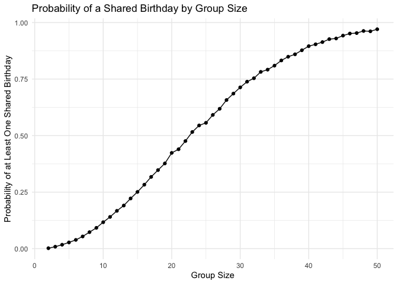
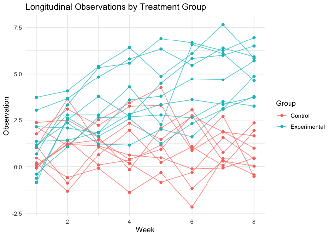
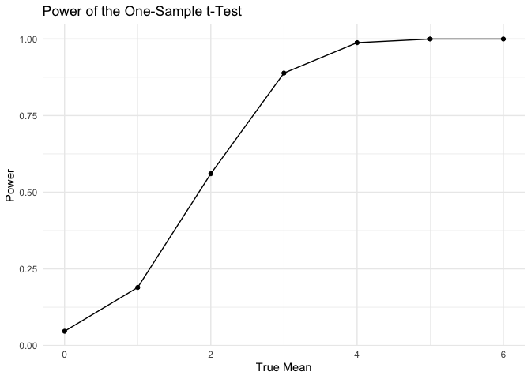
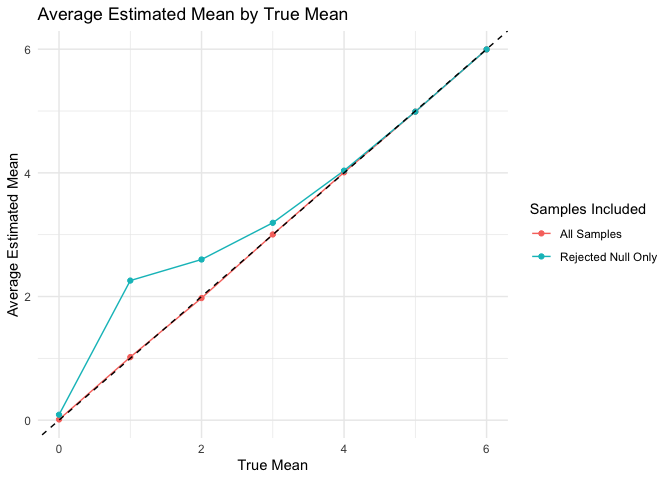

P8105 Homework 5
================
Rezwana Habib
2026-11-17

## Problem 1

``` r
birthday_sim = function(n) {
  
  birthdays = sample(1:365, size = n, replace = TRUE)
  
  any(duplicated(birthdays))
}
```

This function randomly assigns birthdays to a group of `n` people and
returns `TRUE` if at least two people share the same birthday.

``` r
birthday_results =
  tibble(group_size = 2:50) |>
  mutate(
    probability = map_dbl(
      group_size,
      \(n) mean(replicate(10000, birthday_sim(n)))
    )
  )

birthday_results
```

    ## # A tibble: 49 × 2
    ##    group_size probability
    ##         <int>       <dbl>
    ##  1          2      0.002 
    ##  2          3      0.0087
    ##  3          4      0.0174
    ##  4          5      0.0276
    ##  5          6      0.0387
    ##  6          7      0.054 
    ##  7          8      0.073 
    ##  8          9      0.092 
    ##  9         10      0.117 
    ## 10         11      0.140 
    ## # ℹ 39 more rows

``` r
birthday_results |>
  ggplot(aes(x = group_size, y = probability)) +
  geom_line() +
  geom_point() +
  labs(
    title = "Probability of a Shared Birthday by Group Size",
    x = "Group Size",
    y = "Probability of at Least One Shared Birthday"
  ) +
  theme_minimal()
```

<!-- -->

As the number of people in the group increases, the probability that at
least two people share a birthday increases rapidly. For small groups, a
shared birthday is relatively unlikely, but the probability rises
substantially as the group size approaches 20 to 30 people and continues
increasing for larger groups.

## Problem 2

``` r
longitudinal_files =
  tibble(
    file_name = list.files("data")
  )

longitudinal_data =
  longitudinal_files |>
  mutate(
    data = map(
      file_name,
      \(x) read_csv(file.path("data", x), show_col_types = FALSE)
    )
  ) |>
  unnest(data) |>
  mutate(
    subject_id = str_remove(file_name, "\\.csv$"),
    arm = case_when(
      str_starts(file_name, "con") ~ "Control",
      str_starts(file_name, "exp") ~ "Experimental"
    )
  ) |>
  select(subject_id, arm, everything(), -file_name) |>
  pivot_longer(
    cols = starts_with("week"),
    names_to = "week",
    values_to = "observation"
  ) |>
  mutate(
    week = parse_number(week)
  )

longitudinal_data
```

    ## # A tibble: 160 × 4
    ##    subject_id arm      week observation
    ##    <chr>      <chr>   <dbl>       <dbl>
    ##  1 con_01     Control     1        0.2 
    ##  2 con_01     Control     2       -1.31
    ##  3 con_01     Control     3        0.66
    ##  4 con_01     Control     4        1.96
    ##  5 con_01     Control     5        0.23
    ##  6 con_01     Control     6        1.09
    ##  7 con_01     Control     7        0.05
    ##  8 con_01     Control     8        1.94
    ##  9 con_02     Control     1        1.13
    ## 10 con_02     Control     2       -0.88
    ## # ℹ 150 more rows

``` r
longitudinal_data |>
  ggplot(
    aes(
      x = week,
      y = observation,
      group = subject_id,
      color = arm
    )
  ) +
  geom_line(alpha = 0.7) +
  geom_point() +
  labs(
    title = "Longitudinal Observations by Treatment Group",
    x = "Week",
    y = "Observation",
    color = "Group"
  ) +
  theme_minimal()
```

<!-- -->

The control and experimental groups show different patterns over time.
Observations for participants in the experimental group generally
increase across the study period, while observations in the control
group remain relatively stable. This suggests that the experimental
condition may be associated with increasing outcome values over time.

## Problem 3

``` r
sim_ttest = function(mu) {
  
  sample_data = rnorm(
    n = 30,
    mean = mu,
    sd = 5
  )
  
  t.test(sample_data, mu = 0) |>
    broom::tidy() |>
    select(estimate, p.value)
}
```

``` r
set.seed(2026)

simulation_results =
  expand_grid(
    mu = 0:6,
    iteration = 1:5000
  ) |>
  mutate(
    results = map(mu, sim_ttest)
  ) |>
  unnest(results)

simulation_results
```

    ## # A tibble: 35,000 × 4
    ##       mu iteration estimate p.value
    ##    <int>     <int>    <dbl>   <dbl>
    ##  1     0         1   -0.362   0.720
    ##  2     0         2   -0.739   0.305
    ##  3     0         3    0.171   0.865
    ##  4     0         4   -1.14    0.265
    ##  5     0         5    1.49    0.114
    ##  6     0         6    0.150   0.831
    ##  7     0         7    0.808   0.384
    ##  8     0         8    0.534   0.579
    ##  9     0         9    0.677   0.336
    ## 10     0        10    0.494   0.503
    ## # ℹ 34,990 more rows

``` r
power_results =
  simulation_results |>
  group_by(mu) |>
  summarize(
    power = mean(p.value < 0.05)
  )

power_results
```

    ## # A tibble: 7 × 2
    ##      mu  power
    ##   <int>  <dbl>
    ## 1     0 0.0466
    ## 2     1 0.189 
    ## 3     2 0.560 
    ## 4     3 0.889 
    ## 5     4 0.988 
    ## 6     5 1.000 
    ## 7     6 1.000

``` r
power_results |>
  ggplot(aes(x = mu, y = power)) +
  geom_line() +
  geom_point() +
  labs(
    title = "Power of the One-Sample t-Test",
    x = "True Mean",
    y = "Power"
  ) +
  theme_minimal()
```

<!-- -->

As the true mean increases farther from the null value of 0, the power
of the test increases. When the true mean is close to 0, the test is
less likely to reject the null hypothesis, while larger effect sizes are
detected much more frequently.

``` r
mean_estimates =
  simulation_results |>
  group_by(mu) |>
  summarize(
    average_estimate = mean(estimate),
    average_estimate_rejected = mean(estimate[p.value < 0.05]),
    .groups = "drop"
  )

mean_estimates
```

    ## # A tibble: 7 × 3
    ##      mu average_estimate average_estimate_rejected
    ##   <int>            <dbl>                     <dbl>
    ## 1     0           0.0110                    0.0883
    ## 2     1           1.02                      2.26  
    ## 3     2           1.97                      2.60  
    ## 4     3           3.00                      3.19  
    ## 5     4           4.01                      4.04  
    ## 6     5           4.99                      4.99  
    ## 7     6           6.00                      6.00

``` r
mean_estimates |>
  pivot_longer(
    cols = c(average_estimate, average_estimate_rejected),
    names_to = "estimate_type",
    values_to = "mean_estimate"
  ) |>
  mutate(
    estimate_type = recode(
      estimate_type,
      average_estimate = "All Samples",
      average_estimate_rejected = "Rejected Null Only"
    )
  ) |>
  ggplot(
    aes(
      x = mu,
      y = mean_estimate,
      color = estimate_type
    )
  ) +
  geom_line() +
  geom_point() +
  geom_abline(
    slope = 1,
    intercept = 0,
    linetype = "dashed"
  ) +
  labs(
    title = "Average Estimated Mean by True Mean",
    x = "True Mean",
    y = "Average Estimated Mean",
    color = "Samples Included"
  ) +
  theme_minimal()
```

<!-- -->

Across all simulated samples, the average estimated mean is
approximately equal to the true mean, which is consistent with the
sample mean being an unbiased estimator. However, among samples in which
the null hypothesis is rejected, the average estimated mean can differ
from the true mean, particularly when the true effect is small and power
is low. When only statistically significant results are selected,
samples with estimates farther from the null value are more likely to be
included. As the true mean increases and power approaches 1, nearly all
samples reject the null hypothesis, so the average estimate among
rejected tests becomes much closer to the true mean.
